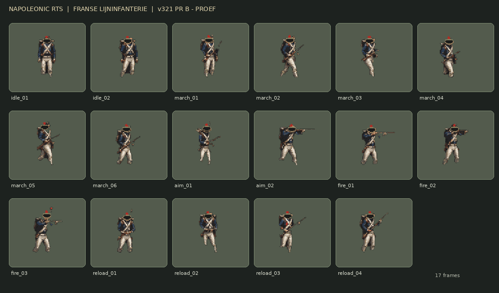

# Franse lijninfanterie — v321 PR B (concept voor beeldreview)

**Status:** kunstconcept / raster-review. **NIET** goedgekeurd als productie-asset en nog niet actief in de RTS of Graphics Lab.

## Wat werkelijk is gemaakt

- Een originele, met OpenAI gegenereerde illustratie van Napoleontische Franse infanteristen met verschillende houdingen.
- Uit die ene compositie zijn **17 verschillende transparante rasterframes** gehaald; de kunst is uitgeknipt met segmentatie, opgeschoond, naar eenzelfde voetlijn geplaatst en als ongetrimde 96×96-cellen verpakt.
- Een echte **576×288 PNG-atlas** en de daarbij passende PixiJS-jsonanimaties (`idle` 2 / `march` 6 / `aim` 2 / `fire` 3 / `reload` 4).
- Herkomst- en SHA-256-framegegevens staan naast de PNG. Het veld `reviewedForUse` blijft **false**; de formele packer moet deze reeks daarom blokkeren zolang de artreview niet is afgerond.
- 4 geautomatiseerde rastercontroles bewaken de PNG-inhoud, alle 17 poses, de vaste voeten, niet-uitstekende transparantie en de lege achttiende cel.

## Artistieke tekortkomingen die we eerst moeten beoordelen

- **Camerahoek:** deze proefafbeelding laat de soldaten schuin van voren/zij zien. Voor de hoofdgame is een vaste, hooggelegen 2D-kijkhoek nodig. De game niet eerst aanpassen aan onjuist perspectief.
- **Houdingscontinuïteit:** individuele ledematen, shako-versieringen en musketten vertonen variaties tussen door AI gerenderde figuren. Dit is een echte 17-frame rasterreeks, maar nog geen professioneel vanuit één rig gerenderde animatie.
- **Segmentatieranden:** in enkele houdingen zitten lichte imperfecties aan musketten/schoenen. Dit moet worden herwerkt vóór vrijgave.
- **Afmeting:** 96 px bronframes worden bij de mobiele gamezoom kleiner getekend. Visuele review moet daarom ook op ca. 29 px lichaamsgrootte gebeuren; niet uitsluitend op een ingezoomde contact sheet.
- **Richtingen:** alle houdingen zijn één referentierichting; de overige bewegingsrichtingen zijn nog niet gemaakt.

### Volgende actie

Beoordeel eerst de look via de contactplaat of de losse atlas. Als de artstijl goed is, maken we de definitieve Franse master vanuit één rig/poppetje en corrigeren de camerahoek; als de stijl onvoldoende is, regenereren we de master in plaats van onrealistische animaties te forceren. **Pas na visuele goedkeuring** zetten we `reviewedForUse` op true, valideren we met de bestaande strikte `validate-infantry-atlas.py` en mergen we de sprites.

De **Britse 17-frame atlas (PR C)** en de **Pixi/Canvas-animatiecontroller (PR D)** volgen later. De gewone RTS blijft ongewijzigd.
